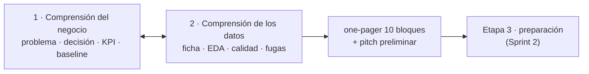

<div align="center">

# 📌 Etapas 1–2 · Comprensión del negocio y de los datos

**Sprint 1 · Etapas 1–2 · cierre mié 30-set · 23:59**

  

</div>

[← Volver a la portada](https://github.com/utec-dsia/pi1-262-g9#readme)

**Meta del sprint.** Dejar en el repositorio, versionadas y reproducibles, las etapas 1 y 2 que se cerraron en la S02 (12 de setiembre): el problema y la decisión que mejora, la métrica primaria y el baseline a vencer, la ficha de datos y el EDA con sus hallazgos; y sostener con esas cifras propias el pitch preliminar.



## Qué debe quedar aquí

| Carpeta / archivo | Qué es | Historia |
|---|---|---|
| `one_pager/` | El one-pager de **10 bloques** con sus casillas C/P/F: el PDF y, si se usó, el Excel del curso (`one_pager/*.xlsx` es la única hoja de cálculo que la guardia admite) | `PB-08` |
| `pitch/` | El deck del pitch preliminar (P1) con el feedback de la sesión virtual incorporado | `PB-08` |
| `codigo/eda.py` | El EDA **reproducible con una sola instrucción** (bloque 9). Puede ser un notebook, pero debe ejecutarse de principio a fin | `PB-06` |
| `resultados/perfilado.json` | Filas, columnas, tipos, nulos, duplicados y distribución del objetivo — **calculados, no copiados** | `PB-05` `PB-07` |
| `resultados/hallazgos.csv` | Tres hallazgos: **cifra + consecuencia para el proyecto + transformación propuesta** para la etapa 3 | `PB-06` |
| `resultados/figuras/` | Las figuras que el one-pager y el pitch citan | `PB-06` |

## Los diez bloques del one-pager

| # | Bloque | Etapa | Historia |
|:-:|---|:-:|---|
| 1 | Problema en una frase | 1 | `PB-01` |
| 2 | La decisión que el proyecto mejora | 1 | `PB-01` |
| 3 | Objetivo de negocio y objetivo de IA (métrica + umbral + baseline) | 1 | `PB-02` |
| 4 | Stakeholders: dueño, usuario, pagador, afectado | 1 | `PB-03` |
| 5 | Evidencia, supuestos, riesgos y plan | 1 | `PB-03` |
| 6 | Datos recolectados: fuente, unidad de análisis, volumen, periodo, objetivo, acceso | 2 | `PB-05` |
| 7 | Tres hallazgos del EDA | 2 | `PB-06` |
| 8 | Calidad de los datos declarada | 2 | `PB-07` |
| 9 | EDA reproducible: la instrucción única | 2 | `PB-06` |
| 10 | Viabilidad técnica, financiera y comercial | 1 | `PB-03` |

> **Criterio de cierre del curso.** Etapa 1 cerrada: bloques 1–5 en **C**. Etapa 2 cerrada: bloques 6–9 en **C** *y* el verificador regeneró el EDA con la instrucción del bloque 9. El bloque 10 se declara siempre y se reevalúa en P2 y en la sustentación.

## Cómo reproducir el EDA

```bash
conda activate pi1
cd etapa_1_2_comprension
python codigo/eda.py        # lee datos.crudo y datos.objetivo de ../etapa_3_preparacion/params.yaml
```

El script es un punto de partida para tablas. En proyectos de texto, imagen, audio o series conserva el contrato —`perfilado.json` + `hallazgos.csv` + `figuras/`— y reemplaza los cálculos por los de tu dominio.

## Fugas de información: la lista que se hereda a la etapa 3

Anota aquí toda variable **posterior al momento de la decisión** o que sea un **proxy del objetivo**. Cada una se convierte en una decisión de exclusión en `etapa_3_preparacion/params.yaml` (`seleccion.columnas_excluidas`) con su entrada en la bitácora.

| Variable | Por qué es sospechosa | Decisión (etapa 3) |
|---|---|---|
| _…_ | _…_ | _excluir · conservar con justificación_ |

## ✅ Lo logrado en esta etapa

> **Lo completa el equipo antes del cierre del sprint.** Es lo primero que lee el evaluador: qué está hecho, dónde está la evidencia y qué queda pendiente. Sin adjetivos: enlaces, cifras y comandos.

| Pieza | Estado | Evidencia |
|---|:-:|---|
| One-pager con los 10 bloques en C | ⬜ | `one_pager/…` |
| Pitch preliminar con feedback incorporado | ⬜ | `pitch/…` |
| EDA reproducible con una instrucción | ⬜ | `codigo/eda.py` · commit `…` |
| Perfilado con cifras reales | ⬜ | `resultados/perfilado.json` |
| Tres hallazgos con cifra, consecuencia y evidencia | ⬜ | `resultados/hallazgos.csv` |
| Calidad de los datos y lista de fugas declaradas | ⬜ | tabla de arriba · bloque 8 |
| Métrica primaria, umbral y baseline declarados | ⬜ | bloque 3 · `PB-02` |

<sub>Estado: ✅ hecho · 🟡 parcial · ⬜ pendiente. Cambia el símbolo y enlaza la evidencia real (archivo, commit, ejecución).</sub>

**Qué queda pendiente y por qué**

- _…_
