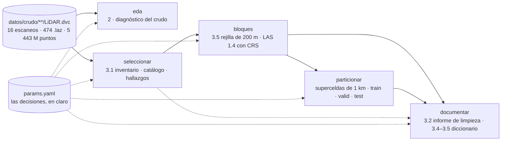

<div align="center">

# 🗃️ Etapa 3 · Preparación de los datos con DVC

**Sprint 2 · Etapa 3 · cierre sáb 17-oct · 23:59**

  

</div>

[← Volver a la portada](https://github.com/utec-dsia/pi1-262-g9#readme)

**Meta del sprint.** Convertir los hallazgos del EDA en un pipeline de preparación declarado en `dvc.yaml` y parametrizado en `params.yaml`, con los datos crudos versionados y un remoto operativo, la partición anti-fuga como etapa del grafo, el diccionario de datos y el informe de limpieza como salidas declaradas, y la reproducibilidad verificada desde un clon limpio.

## El grafo del pipeline



El proyecto trabaja con **nubes de puntos LiDAR**, no con una tabla. Por eso las
cinco etapas no calcan las de la plantilla: cada una apunta en su `desc` a la
entrada de la bitácora que la justifica. Las tareas 3.2 (limpiar), 3.3
(construir) y 3.4 (integrar) no tienen etapa propia, y el motivo está escrito en
[0022](../docs/decisiones/0022-informe-de-limpieza-y-diccionario-generados.md):

| Tarea | Dónde | Por qué así |
|---|---|---|
| 3.1 seleccionar | `seleccionar` | entran todas las nubes `.laz`; las columnas, por `select.keep_dimensions` |
| 3.2 limpiar | `documentar` | **no se elimina ningún punto por ruido**: los postes y cables son objetos delgados, justo lo que un filtro de atípicos borra ([0004](../docs/decisiones/0004-el-sor-destruye-los-cables.md)). Lo que se corrige (CRS, color) se corrige al escribir el bloque, y `documentar` lo mide |
| 3.3 construir | — | los rasgos dependen de la red que se elija en el Sprint 3; se construirán dentro del entrenamiento |
| 3.4 integrar | — | hay una sola fuente. La única unión es etiqueta ↔ punto, por coordenada, en `herramientas/registrar_anotacion.py` |
| 3.5 dar formato | `bloques` | rejilla de 200 m anclada a UTM, LAS 1.4 con EPSG:32718 ([0018](../docs/decisiones/0018-el-bloque-de-anotacion-sustituye-a-la-tesela.md)) |
| partición | `particionar` | por superceldas espaciales, no por escaneo, porque los escaneos se solapan ([0024](../docs/decisiones/0024-particion-por-superceldas.md)) |

**Alcance de clases** ([0023](../docs/decisiones/0023-solo-postes-con-su-luminaria.md)):
**poste de BT** (id 5) y **poste de MT** (id 12). Si el poste tiene luminaria,
la luminaria es parte del poste. Las demás clases quedan `en_espera` en
`params.yaml: ontology` para el próximo proyecto integrador.

## Qué hay aquí

| Archivo | Qué es | Va a Git |
|---|---|:-:|
| `dvc.yaml` | La receta: cinco etapas con sus dependencias | ✅ |
| `params.yaml` | **Todas** las decisiones con número: rejilla, muestreo, partición, ontología, semilla | ✅ |
| `dvc.lock` | La anotación: huella `md5` de cada entrada y salida, y los parámetros usados | ✅ **siempre** |
| `codigo/seleccionar.py` · `bloques.py` · `particionar.py` · `documentar.py` | Una etapa por script | ✅ |
| `codigo/common/` | Lectura/escritura de nubes (`io_cloud`), rutas y parámetros (`config`), anotación | ✅ |
| `../etapa_1_2_comprension/codigo/eda.py` | El EDA, como etapa `eda` del mismo grafo | ✅ |
| `herramientas/` | Lo que usa una persona, no el pipeline: registrar recortes anotados, ubicar un bloque en Street View, configurar las credenciales de R2 | ✅ |
| `reportes/*.json` | Métricas de cada etapa (`raw_profile`, `bloques`, `particion`, `informe_limpieza`) | ✅ (`cache: false`) |
| `reportes/informe_limpieza.md` | El informe de limpieza legible, generado por `documentar` | ✅ (`cache: false`) |
| `../docs/diccionario/diccionario.csv` · `.md` | Generados por `documentar`: cada campo del punto, del índice de bloques y de la tabla final | ✅ (`cache: false`) |
| `../datos/crudo/**/*.dvc` | Un puntero por escaneo (nube y trayectoria) | ✅ |
| `../datos/intermedio/catalogo/` | Inventario con MD5 y catálogo por archivo: son tablas, así que van por DVC | ❌ (remoto) |
| `../datos/intermedio/01_bloques/` | Los bloques, ~49 GB. `push: false`: se reconstruyen idénticos desde el crudo ([0002](../docs/decisiones/0002-almacenamiento-y-remotos.md)) | ❌ |
| `../datos/final/particion.csv` | La tabla final: cada bloque y su partición | ❌ (remoto) |

## Puesta en marcha

```bash
conda env create -f environment.yml && conda activate pi1
python etapa_3_preparacion/herramientas/configurar_r2.py --credenciales   # token de R2 (solo lectura basta)
dvc pull datos/crudo                                  # ~35 GB: las nubes y la trayectoria

cd etapa_3_preparacion
dvc dag
dvc repro                                             # eda → seleccionar → bloques → particionar → documentar
dvc metrics show
```

La primera corrida tarda **unas 3 h**, casi todo en `bloques`, que reparte los
5 443 M puntos en la rejilla. Las demás etapas tardan minutos.

**La prueba de reproducibilidad** (desde un clon limpio):

```bash
dvc pull datos/crudo && cd etapa_3_preparacion && dvc repro -f && git diff --exit-code dvc.lock && echo REPRODUCIBLE
```

`bloques` no está en el remoto, así que `dvc repro -f` lo rehace desde el crudo.
Esa es justo la comprobación que importa: que el corte sale idéntico.

## Cómo se anota

1. Abre un bloque de `datos/intermedio/01_bloques/<grupo>/<distrito>/<escaneo>/` en CloudCompare.
2. Recorta **un poste entero**, luminaria incluida si la tiene, y guárdalo como
   `recortes/b_<ix>_<iy>__poste_bt.laz` o `__poste_mt.laz`. La clase la pone el nombre del archivo.
3. `python herramientas/registrar_anotacion.py recortes/*.laz` y después
   `dvc add ../datos/crudo/anotacion && dvc push`.
4. `python herramientas/ubicar.py b_<ix>_<iy> --abrir` abre la calle en Street View
   cuando la nube no basta para decidir.

## Los siete criterios de aceptación

Verificables por un tercero, sin preguntar al equipo:

| # | Criterio | Cómo se comprueba |
|:-:|---|---|
| 1 | **Reproducibilidad** | Desde un clon nuevo, `dvc pull` + `dvc repro -f` termina sin error y `dvc.lock` queda idéntico |
| 2 | **Separación de datos y código** | Ninguna tabla en el historial; el crudo aparece solo como puntero; no hay punteros en `intermedio/` ni `final/` |
| 3 | **Cobertura de decisiones** | Cada etapa apunta a su entrada en `docs/decisiones/` y cada entrada está citada por al menos un commit |
| 4 | **Parametrización** | Ningún umbral, lista ni constante de negocio dentro del código: el bloque `params` de `dvc.lock` no está vacío |
| 5 | **Diccionario de datos** | Cubre el 100 % de las columnas de la tabla final y es salida declarada de una etapa |
| 6 | **Informe de limpieza** | Es salida de una etapa con métricas declaradas, no un documento suelto |
| 7 | **Traza de colaboración** | `main` protegida, todo cambio entró revisado y cada PR enlaza el Issue que resuelve |

<details>
<summary><b>Siete antipatrones y su señal</b></summary>

1. **Publicar solo la mitad** — el código sube y los datos no. Señal: `dvc status -c` muestra desincronización con el remoto.
2. **Datos dentro del historial** — una tabla entró antes de registrarla. Señal: el clon pesa cientos de MB.
3. **Salidas huérfanas** — un derivado registrado a mano con `dvc add`. Señal: punteros `.dvc` en `intermedio/` o `final/`.
4. **Corregir la salida a mano** — la siguiente ejecución la destruye. Se corrige el código o el parámetro.
5. **Salidas sin declarar** — la etapa escribe algo que no está en `outs`: no se guarda, no se publica, no queda anotado.
6. **Constantes escondidas en el código** — el bloque `params` de `dvc.lock` está vacío.
7. **Un solo cambio gigante** — no queda ninguna decisión aislada que revisar o revertir.

</details>

## ✅ Lo logrado en esta etapa

> Estado al cierre del sprint 2 (sábado 17-oct-2026). Cifras tomadas de las salidas del pipeline, no escritas a mano.

| Pieza | Estado | Evidencia |
|---|:-:|---|
| Crudo registrado (`.dvc`) y remoto operativo (`dvc push` / `dvc pull`) | ✅ | 32 punteros en [`../datos/crudo/`](../datos/crudo/) (16 escaneos: nube y trayectoria) · remoto Cloudflare R2 en `../.dvc/config` · `dvc status --cloud` responde y el crudo está en sincronía |
| Versiones del crudo etiquetadas (`datos-v1`, `datos-v2`…) | ✅ | `git tag -n datos-v1` |
| Pipeline completo: `dvc dag` y `dvc repro` sin error | ✅ | `dvc.yaml` (5 etapas) · `dvc.lock` |
| Decisiones parametrizadas (bloque `params` de `dvc.lock` no vacío) | ✅ | `params.yaml`: rejilla, muestreo del perfil, partición, ontología, semilla; cada etapa los declara y quedan en `dvc.lock` |
| Bitácora: una entrada por decisión, citada por commits | ✅ | 24 entradas en [`../docs/decisiones/`](../docs/decisiones/) con mapa a las decisiones reservadas en su README; el historial del grupo (desde el 11-sep) está unido a este repositorio |
| Partición anti-fuga como etapa (estrategia justificada) | ✅ | `reportes/particion.json` · [0024 · superceldas espaciales](../docs/decisiones/0024-particion-por-superceldas.md) |
| Diccionario de datos generado (100 % de columnas descritas) | ✅ | [`../docs/diccionario/diccionario.csv`](../docs/diccionario/diccionario.csv) · `.md`; la etapa falla si un campo queda sin descripción |
| Informe de limpieza generado | ✅ | `reportes/informe_limpieza.json` · [`reportes/informe_limpieza.md`](reportes/informe_limpieza.md) |
| Reproducibilidad verificada desde un clon limpio por otro integrante | ⬜ | pendiente: ver abajo |

<sub>Estado: ✅ hecho · 🟡 parcial · ⬜ pendiente.</sub>

**Cifras de la corrida**

- Crudo: **474 nubes .laz**, **5 443 246 642 puntos**, 34.623 GB comprimidos, 16 escaneos en 2 distritos.
- Hallazgos de calidad emitidos por `seleccionar`: Q1 (header.crs), Q2 (classification), Q3 (number_of_returns), Q4 (red/green/blue), Q5 (density).
- `bloques`: **799 bloques** de 200 m, 5 443 203 444 puntos de núcleo (6 651 064 655 con el anillo de 10 m).
- `particionar`: train 40 superceldas / 578 bloques / 68.9% de los puntos · valid 14 superceldas / 144 bloques / 16.2% de los puntos · test 3 superceldas / 77 bloques / 14.9% de los puntos; ids de bloque en dos particiones: **0**.
- `documentar`: 5 hallazgos respondidos (2 corregidos, 1 pendiente); evidencia que cumple 5/5; controles 3/3; 43 198 puntos fuera de bloques (0.000794 %, bloques bajo `tiling.min_points`).

**Qué queda pendiente y por qué**

- **Reproducibilidad por otro integrante.** `dvc repro -f` desde un clon limpio la tiene que hacer alguien distinto del autor. Cuesta ~3 h por `bloques` y queda para Bruno o Raúl en el sprint 3. El trabajo de reproducibilidad del CI no se activa: el runner gratuito no aguanta 3 h ni 35 GB.
- **Revisión del PR por otro integrante (criterio 7).** El PR se abre hoy y queda pendiente de aprobación.
- **Verdad de campo.** Hay ~30 postes BT etiquetados en un bloque de ate, todavía sin registrar con `herramientas/registrar_anotacion.py`. Se registran (`dvc add ../datos/crudo/anotacion`) al terminar ese bloque. Sin más etiquetas no hay entrenamiento: es el camino crítico del sprint 3 (hallazgo Q2).
- **El inventario cuenta un archivo de más.** `reportes/raw_profile.json` dice 491 archivos crudos porque incluye `datos/crudo/README.md`. Se corrige excluyendo los `.md` en `seleccionar`. No afecta a las nubes ni a los bloques, solo a ese conteo.
- **Bloques fuera del remoto.** `datos/intermedio/01_bloques` (~49 GB) tiene `push: false` a propósito ([0002](../docs/decisiones/0002-almacenamiento-y-remotos.md)): se regenera idéntico desde el crudo.
