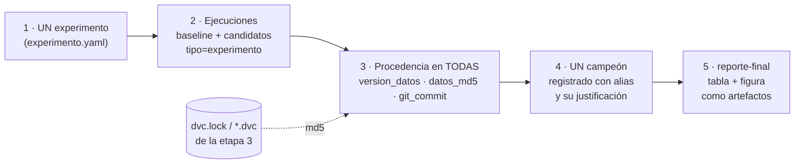

<div align="center">

# 🧪 Etapas 4–5 · Modelado y evaluación con MLflow

**Sprint 3 · Etapas 4–5 (+6) · cierre sáb 31-oct · 23:59**

  

</div>

[← Volver a la portada](https://github.com/utec-dsia/pi1-262-g9#readme)

**Meta del sprint.** Registrar en un único experimento de MLflow el baseline y los candidatos con procedencia completa (`datos_md5`, `git_commit`), evaluarlos con honestidad frente a la métrica primaria, traducir el resultado a unidades del negocio, promover un campeón con alias y entregar un prototipo en Python que un tercero pueda ejecutar sin ayuda del equipo.

## Las cinco piezas del entregable



> La prueba que lo resume todo: que un evaluador abra la interfaz, elija **una ejecución cualquiera** y pueda decir, sin preguntarle a nadie, **qué datos, qué código, qué configuración y qué obtuvo**. Y la pregunta que sigue: **por qué ese campeón y no el de arriba de la tabla.**

## Qué hay aquí

| Archivo | Qué es | Va a Git |
|---|---|:-:|
| `experimento.yaml` | **El vocabulario**: experimento `deteccion-postes-lidar`, métrica primaria `recuperacion`, modelo `detector-postes`, alias | ✅ |
| `scripts/servidor_mlflow.sh` | Levanta el servidor con `sqlite:///mlflow.db` | ✅ |
| `cuadernos/` | Un cuaderno por modelo: `sonata_mlp.ipynb` y `baseline_geometrico.ipynb`. Necesitan GPU y el entorno de Sonata | ✅ |
| `codigo/postes/` | Datos, rasgos, partición por carpetas, evaluación por objeto y barrido de hiperparámetros | ✅ |
| `codigo/registrar_experimentos.py` | Crea en MLflow una ejecución por experimento, con procedencia, desde `resultados/experimentos/` | ✅ |
| `codigo/modelo_postes.py` | La cabeza MLP como modelo de MLflow, sin depender de torch | ✅ |
| `codigo/evaluar.py` · `promover.py` · `reporte.py` | Tabla comparable, campeón con alias y ejecución `reporte-final` | ✅ |
| `codigo/reporte_html.py` | Genera el reporte navegable | ✅ |
| `resultados/reporte_mlflow.html` | **El reporte para revisar**: un solo archivo, se abre sin instalar nada | ✅ |
| `resultados/experimentos/` | Resúmenes y figuras de cada corrida. Los pesos van por DVC | ✅ |
| `mlflow.db` · `mlartifacts/` | La base de seguimiento y los artefactos | ❌ **nunca** |

## Cómo se reproduce

El entrenamiento y el registro corren en dos entornos: Sonata exige GPU, y MLflow no necesita ninguno de sus paquetes.

```bash
# Requiere la credencial de lectura de R2 en .dvc/config.local
dvc pull datos/crudo/etiquetado.dvc \
  etapa_4_5_modelado_evaluacion/resultados/experimentos/*.pt.dvc \
  etapa_4_5_modelado_evaluacion/resultados/experimentos/v2_cabeza_pesos.npz.dvc \
  etapa_4_5_modelado_evaluacion/resultados/experimentos/v2_cabeza_comprobacion.npz.dvc

bash etapa_4_5_modelado_evaluacion/scripts/servidor_mlflow.sh    # en otra terminal → http://127.0.0.1:5000

cd etapa_4_5_modelado_evaluacion
python codigo/registrar_experimentos.py     # 36 ejecuciones de modelos y 3 de barrido (v1 a v7, sin v6)
python codigo/evaluar.py                    # resultados/comparacion_modelos.csv
python codigo/promover.py --run-id "$(cat resultados/run_campeon.txt)" --justificacion "…"
python codigo/reporte.py                    # la ejecución reporte-final
python codigo/reporte_html.py               # resultados/reporte_mlflow.html
```

Para reentrenar, en el entorno de Sonata: `cuadernos/baseline_geometrico.ipynb`, `cuadernos/sonata_mlp.ipynb` y `python codigo/postes/barrido_modelos.py`. El cuaderno elige la clase con `CLASE_OBJETIVO` (o la variable `POSTES_CLASE`).

Las corridas v4 se entrenaron en el clúster Khipu de UTEC, en CPU, con `scripts/khipu/` (desde la raíz del repo, con `KHIPU=usuario@khipu.utec.edu.pe` y una llave SSH autorizada): `subir.sh` sube código, etiquetas y caches; `sbatch --export=ALL,POSTES_CLASE=BT etapa_4_5_modelado_evaluacion/scripts/khipu/entrenar_cpu.slurm` entrena; `bajar.sh` trae y ordena los resultados. Khipu no tiene el entorno de Sonata: las caches de rasgos (`datos/intermedio/cache/sonata/`, o donde diga `POSTES_CACHE`) se generan antes con `codigo/postes/preparar_sonata.py` en una máquina con GPU.

## El vocabulario que no se negocia

| Elemento | Regla | Por qué |
|---|---|---|
| Experimento | **Uno** para todo el proyecto | Siete experimentos («final», «final2») no se comparan entre sí |
| Métricas | Mismos nombres en todas las ejecuciones (`f1`, no `f1_score`) | La tabla se ordena por columna |
| Etiqueta `tipo` | `experimento` · `barrido` · `campeon` · `reporte` | Filtrar por **igualdad**: un `!=` sobre una etiqueta ausente devuelve cero filas |
| Etiquetas de procedencia | `version_datos` · `datos_md5` · `git_commit` en **todas** | Sin ellas una ejecución es inservible: no se sabe con qué datos se midió |
| Conjunto | `valid` para buscar; `test` **solo** para el candidato final | Reportar `best_score_` de la búsqueda es sesgo de selección |
| Campeón | **Uno**, con alias, con justificación | El prototipo consume `models:/<nombre>@campeon`; cambiar de campeón es mover el alias |

## Adaptarlo a tu proyecto

- **Tablas:** cambia `tarea`, `metrica_primaria` y `datos.objetivo` en `experimento.yaml`; añade modelos o rejillas en `comun.MODELOS` / `comun.REJILLAS`.
- **Deep learning (PyTorch / TensorFlow):** entrena aparte y registra con `mlflow.pytorch.log_model(..., input_example=…)` conservando **las mismas métricas y etiquetas**. `mlflow.pytorch.autolog()` solo instrumenta PyTorch Lightning: con un bucle `for` no registra nada.
- **Transformadores propios:** ponlos en un módulo importable y decláralos en `comun.TIPOS_CONFIABLES` (+ `code_paths`); MLflow serializa scikit-learn con *skops* y rechaza al registrar los tipos no declarados.
- **Búsqueda bayesiana / Optuna:** mismo patrón que `barrido.py`: una ejecución hija por prueba.

## Los siete criterios de aceptación

| # | Se acepta si… | El error de siempre |
|:-:|---|---|
| 1 | El servidor arranca con `sqlite` y **alguien más** reproduce una ejecución desde cero | `mlflow ui` sobre `./mlruns` |
| 2 | Hay ejecuciones suficientes (baseline + ≥ 2 familias, barridos) sobre **≥ 2 versiones de datos** | Un experimento nuevo por cada prueba |
| 3 | **Todas** llevan `version_datos` y `datos_md5` | Ejecuciones sin versión: no se pueden filtrar |
| 4 | Las métricas se llaman **igual** en todas | `f1` y `f1_score` no se ordenan juntas |
| 5 | Hay **un** modelo registrado con alias y justificación | Tres campeones y ninguno con alias |
| 6 | Existe `reporte-final` con tabla y figura | Capturas de pantalla sueltas |
| 7 | `mlflow.db` y `mlartifacts/` **no** están en Git | `mlflow.db` subido en el primer commit |

## ✅ Lo logrado en esta etapa

Reporte navegable: [`resultados/reporte_mlflow.html`](resultados/reporte_mlflow.html). Descárgalo y ábrelo en el navegador.

| Pieza | Estado | Evidencia |
|---|:-:|---|
| Vocabulario acordado y escrito | ✅ | `experimento.yaml` |
| Baseline registrado con procedencia | ✅ | `geo_hgb-v2-valid` y `geo_hgb-v2-test` |
| Candidatos: 3 familias, barridos anidados | ✅ | `barrido-geo_hgb`, `barrido-sonata_lineal`, `barrido-sonata_mlp`: 9 combinaciones |
| 2 o más versiones de datos evaluadas | ✅ | `etiquetas-v1` a `etiquetas-v7` (v6 sin corridas propias). No comparables cifra a cifra |
| Tabla comparativa reproducible | ✅ | `resultados/comparacion_modelos.csv` |
| Validación honesta del candidato final | 🟡 | `sonata_mlp-256x128-v2-test`. Con este test ya se había visto el resultado al confirmar el campeón |
| Veredicto de negocio | 🟡 | Cualitativo en el reporte. La traducción a horas queda para el informe P2 |
| Campeón con alias y justificación | ✅ | `models:/detector-postes@campeon`, versión 1 |
| `reporte-final` con tabla y figura | ✅ | Ejecución `reporte-final`, con el HTML como artefacto |
| Reproducción por otra persona | ⬜ | Pendiente en el equipo (criterio 1) |

**Resultado en test, 23 postes:** el campeón halla 18 con precisión de 46 %; el baseline, 13 con 47 %. El único poste de MT de test no se detecta.

**Etiquetas v3 (7-nov), un modelo por clase:** 28 recortes en 3 escaneos, solo recortes (la nube sale de `datos/intermedio/01_bloques`). El modelo solo BT halla 32 de 48 postes de test con precisión de 44 %; el solo MT, 1 de 2. La partición cambió, así que no se comparan con v2 cifra a cifra. El campeón sigue siendo el de v2, el único que detecta las dos clases a la vez.

**Etiquetas v4 (11-nov), una carpeta por clase:** 45 recortes en 4 escaneos, en `<escaneo>/poste_bt/<train|test>/` y `<escaneo>/poste_mt/<train|test>/`; cada modelo toma la partición de su clase. BT, con 204 postes en train, halla 56 de 80 postes de test con precisión de 67 % (en v3, 53 %). MT, solo con Ate, halla 8 de 12 con 50 %. Una curva de aprendizaje mostró que más postes de BT casi no suben la recuperación; más bloques sí suben la precisión.

**Etiquetas v5 (11-nov):** 51 recortes; MT suma 6 bloques de AVP01MT2611202502 (55 postes MT en train). Solo se reentrenó MT: halla 8 de 11 postes de test con precisión de 53 %, AP de validación 0,959.

**Etiquetas v7 (14-nov):** 74 recortes; MT suma Pachacámac (escaneos 01 a 03) y 3 bloques más de AVP02, y BT suma el escaneo 03: 212 postes BT y 88 MT en train. El test de MT pasa a 11 postes, en Ate y Pachacámac.

| Ejecución (test) | Postes hallados | Precisión | AP valid. | Umbral |
|---|---|---|---|---|
| `sonata_mlp_solo_bt-256x128-v7` | 52 / 80 | 57 % | 0,939 | 0,80 |
| `sonata_mlp_solo_bt-256x128-neg-v7` | 59 / 80 | 48 % | 0,942 | 0,70 |
| `sonata_mlp_solo_mt-256x128-v7` | 9 / 11 | 47 % | 0,975 | 0,45 |
| `sonata_mlp_solo_mt-256x128-neg-v7` | 9 / 11 | 47 % | 0,975 | 0,45 |

`-neg`: los negativos difíciles dejan fuera el fondo con puntuación ≥ 0,5 y forma de poste, que casi siempre es un poste sin etiquetar. El AP de validación casi no cambia, y en MT gana la ronda sin negativos difíciles, así que el modelo es el mismo. Esa búsqueda halló unos 160 objetos aislados con forma de poste y sin etiqueta en los bloques de train, que se están revisando. Si en test pasa lo mismo, parte de los «inventados» son postes reales y la precisión medida queda por debajo de la real. MT mejora con cada tanda de etiquetas (AP 0,959 → 0,975). BT no sube en test porque su test es sobre todo de Ate y su train, de Pachacámac. Los pesos de v2 a v7 están en DVC (`resultados/experimentos/*.pt.dvc`).

**Qué queda pendiente y por qué**

- **MT:** en v2 se aprende con 7 postes y se mide con 1; en v3, con 13 y 2; en v4, con 35 y 12, todos de Ate. Hacen falta más recortes antes de afirmar que se detecta esa clase.
- **Precisión:** falta revisar en Street View los candidatos sin etiqueta, que pueden ser postes aún no recortados.
- **Estimación:** 12 postes en validación y 23 en test son pocos; falta validación cruzada por bloques.
- **Prototipo:** `prototipo/app.py` carga el campeón, pero su formulario pide los 256 rasgos. Adaptarlo a una nube es trabajo de P4.
- **Partición:** ver [0026](../docs/decisiones/0026-particion-de-entrenamiento-por-carpetas.md).
