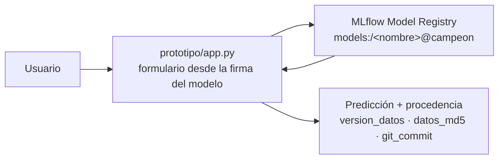

<div align="center">

# 🐍 Prototipo en Python

**Sprint 3 · Etapas 4–5 (+6) · cierre sáb 31-oct · 23:59**

  

</div>

[← Volver a la portada](https://github.com/utec-dsia/pi1-262-g9#readme)

Un tercero debe poder **levantarlo con este README, sin ayuda del equipo**. Es el punto de partida del entregable final: datos → modelo → interfaz. El agente propone, la persona dispone.



## Ejecutar

```bash
conda activate pi1
bash etapa_4_5_modelado_evaluacion/scripts/servidor_mlflow.sh   # terminal 1: el servidor con el campeón registrado
streamlit run prototipo/app.py                                  # terminal 2 → http://localhost:8501
```

Si no hay campeón registrado, la app lo dice y explica cómo registrarlo (`codigo/promover.py`).

## Qué hace hoy y qué falta

> **Lo completa el equipo.** Este mapa es parte del *code freeze* (P4): lo que el jurado evalúa es lo que funciona a la fecha de corte.

| Funcionalidad | Estado | Nota |
|---|:-:|---|
| Carga del campeón por alias desde el Model Registry | ✅ | `app.py` |
| Formulario generado desde la firma del modelo (o carga de CSV) | ✅ | tipos ajustados a la firma |
| Predicción y procedencia visibles | ✅ | barra lateral |
| _Lectura de negocio del resultado (umbral, costo del error, recomendación)_ | ⬜ | _PB-19_ |
| _Agente LLM con herramientas sobre el modelo o los datos_ | ⬜ | _si el proyecto lo contempla_ |
| _Despliegue (contenedor, URL pública)_ | ⬜ | _etapa 6 · horizonte_ |

## Reemplazar Streamlit

Gradio, FastAPI + HTML o un notebook con `ipywidgets` sirven igual. Lo que **no cambia** es el contrato:

- el prototipo consume el modelo **por alias**, nunca por número de versión ni por archivo `.pkl` copiado a mano;
- muestra junto al resultado **qué versión de datos y qué commit** lo produjeron;
- se levanta con las instrucciones de este README en una máquina limpia.

## Instrucciones para el jurado

> **Lo completa el equipo** antes del *code freeze*: URL de la demo, video de respaldo (3–5 min), tag del repositorio y SHA del commit congelado.

| | |
|---|---|
| **Tag / commit** | `…` |
| **URL de la demo** | _…_ |
| **Video de respaldo** | _…_ |
| **Datos de prueba** | _…_ |
